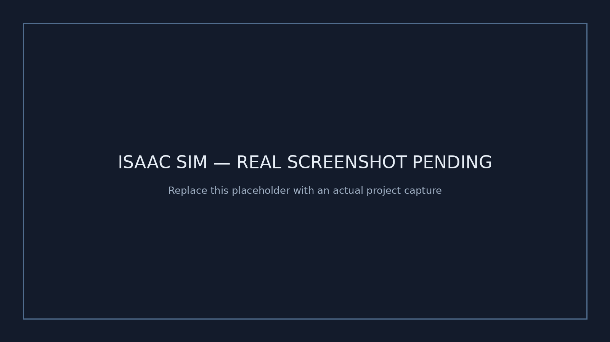
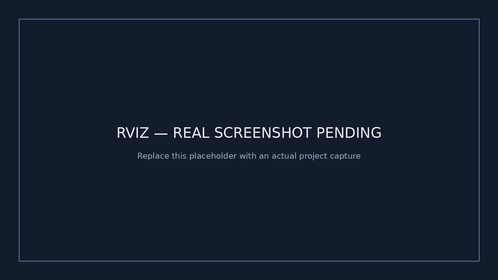
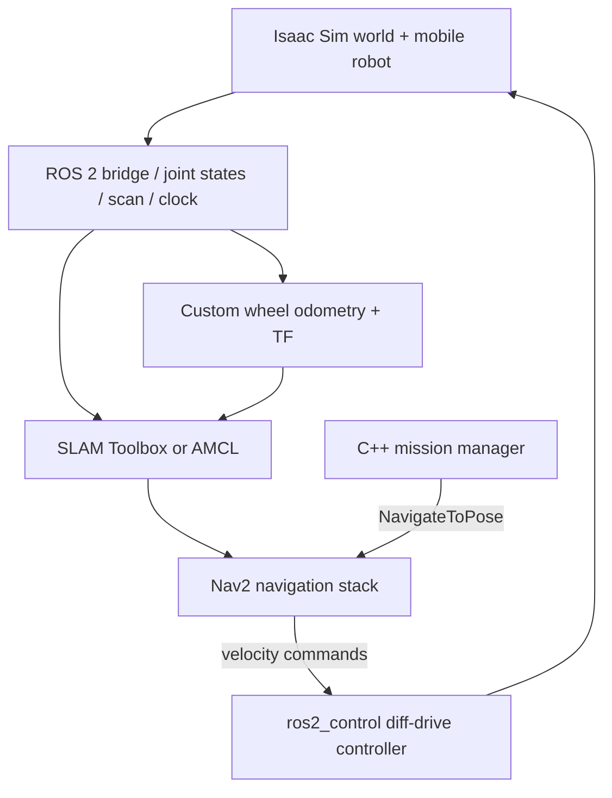

# Autonomous Semantic Navigation Robot

**ROS 2 Jazzy · NVIDIA Isaac Sim · Nav2 · C++ / Python · LiDAR · Mobile robotics**

An indoor autonomous-mobile-robot development project connecting a simulated differential-drive platform to ROS 2 sensing, wheel odometry, mapping, localization, navigation, and mission supervision. The long-term roadmap covers simulation validation, physical deployment, and semantic perception.

> **Status — October 2026:** Recorded validation supports wheel-odometry calibration and sensor/TF/SLAM integration. The saved-map AMCL + Nav2 launch configuration and C++ mission manager are in the repository; repeatable end-to-end navigation and safety acceptance have **not** yet been demonstrated in the available reports. Physical deployment and object-driven semantic navigation remain future work.

[**Demo & media**](#demonstrations) · [**Architecture**](docs/ARCHITECTURE.md) · [**Setup & launch**](docs/GETTING_STARTED.md) · [**Validated results**](docs/VALIDATION.md) · [**Roadmap**](docs/PROJECT_STATUS.md)

## Demonstrations

The project is being prepared for real screenshots and navigation video. **No representative stock images or fabricated demonstration footage are used.** The following slots are designed so the actual assets can be uploaded without rewriting the README:

### Isaac Sim — robot and indoor world



### RViz — localization, LiDAR and navigation



**Video:** [Navigation demonstration — replace pending placeholder](media/videos/navigation-demo.mp4) · [Optional mission manager demo](media/videos/mission-manager-demo.mp4)

See the [capture checklist and exact filenames](media/README.md). A path being present is **not** proof that the depicted feature has passed acceptance.

## Software architecture



This is a simplified **code-derived** architecture; [the technical architecture document](docs/ARCHITECTURE.md) identifies topic names, package boundaries and mapping-vs-localization TF ownership.

## What this project implements

- **ROS 2 systems integration:** Separate packages for robot description, Isaac Sim integration, launch profiles, Nav2/AMCL/SLAM configuration and mission management.
- **Wheel-derived odometry:** Custom Python node consuming wheel feedback to publish `/odom` and `odom → base_link`; Isaac ground-truth pose is used for *evaluation only*.
- **Mission supervision:** C++ node with readiness checks, `NavigateToPose` action client, status publishing, cancellation service, timeout handling and bounded retry logic. These features are **implemented, not all acceptance-tested**.
- **Controlled validation:** Recorded motion/odometry comparisons, simulation-clock and sensor-rate checks, TF checks and functional SLAM integration.
- **Experimental depth coverage:** A Python `coverage_node` prototype uses map and depth information; this is **not** object-level semantic navigation.

**Attribution:** Nav2, AMCL, SLAM Toolbox and ros2_control provide their standard navigation, localization, SLAM and control algorithms. The engineering contribution here is integration, configuration, custom nodes, simulation and validation—not authorship of those underlying frameworks.

## Recorded evidence

| Test | Result from dated reports | Limitation |
|---|---|---|
| Step 8B — stationary-turn wheel odometry | **3.40°** worst endpoint heading error in six turns after calibration | Simulation; not generalized localization accuracy |
| Step 8B — reopened-scene arcs | **1.63 cm / +2.82°** forward-left and **1.27 cm / +1.17°** reverse-right endpoint errors | Two tested curves, not a navigation success rate |
| Step 9 — sensor publishing | LiDAR **10 Hz**, `/odom` **~50 Hz**, 3,600-beam LiDAR | Frequencies measured per **simulated** second |
| Step 9 — mapping stack | SLAM Toolbox active; `/map` and `map → odom` observed | Does not validate AMCL or autonomous goal success |
| Step 9 — runtime speed | Mean real-time factor **0.41–0.46** | Below provisional **0.95** RTF target |

Read [methodology, primary links and caveats](docs/VALIDATION.md). No new test results were generated for this documentation update.

## Project progress

| Stage | Current state |
|---|---|
| **V1 — simulated autonomy** | **In progress.** Wheel odometry, sensors and mapping integration have measured evidence; AMCL, mission reliability and safety validation remain open. |
| **V2 — physical robot** | **Planned.** Hardware-oriented configurations exist but deployment is not claimed. |
| **V3 — semantic navigation** | **Exploratory/planned.** Depth-coverage prototype exists; object recognition and object-guided goals are not demonstrated. |

## Repository organization

```text
autonomous-semantic-navigation/
├── ros2_ws/src/
│   ├── asn_bringup/               # ROS 2 launch profiles
│   ├── asn_description/           # Robot URDF / description
│   ├── asn_simulation/            # Controller configuration and wheel odometry
│   ├── asn_navigation/            # Nav2, AMCL, SLAM, maps and RViz
│   ├── asn_mission/               # C++ mission manager
│   ├── asn_semantical_navigation/ # Experimental depth coverage node
│   └── asn_test/                  # ROS package test scaffolding
├── isaac_sim/                     # USD worlds and robot assets
├── tests/                         # Independent validation scripts
├── results/                       # Raw experiments and reports
├── docs/                          # Engineering documentation
├── media/                         # Screenshots and demo videos
└── backups/                       # Historical configuration backups
```

Original specifications, debug records, older world versions and raw results remain available for engineering traceability. [Documentation index](docs/README.md).

## Quick start

Documented development environment: **Ubuntu 24.04, ROS 2 Jazzy, Isaac Sim 6.1.0-rc.26.** An installed/configured Isaac Sim ROS 2 bridge, Nav2, SLAM Toolbox, ros2_control, RViz and ROS build tools are necessary. The workstation-specific **Isaac Safe launcher is not distributed here**. This is not currently a one-command clean install.

```bash
git clone https://github.com/JanCuesta/autonomous-semantic-navigation.git
cd autonomous-semantic-navigation/ros2_ws
source /opt/ros/jazzy/setup.bash
rosdep install --from-paths src --ignore-src -r -y
colcon build --symlink-install
source install/setup.bash
```

Open `isaac_sim/worlds/Testing_World+Robot.usd` in Isaac Sim with the ROS bridge/controller manager configured and running. Then, in **separate sourced terminals**:

```bash
ros2 launch asn_bringup simulation.launch.py
ros2 launch asn_bringup navigation.launch.py
ros2 run asn_mission mission_manager
ros2 run rviz2 rviz2 -d "$(ros2 pkg prefix asn_navigation)/share/asn_navigation/rviz/v3_rviz.rviz"
```

The checked-in AMCL launch currently selects **`v4_sim_map.yaml`**. In RViz, initialize the pose, wait for interfaces to be ready, and send a mission goal via the configured goal tool (`/mission/goal`). The commands are **code-derived** and have not been clean-machine verified as part of this presentation update. See [full launch instructions](docs/GETTING_STARTED.md), including mapping mode and troubleshooting.

## Documentation and links

- [Architecture and ROS interfaces](docs/ARCHITECTURE.md)
- [Installation / build / run guide](docs/GETTING_STARTED.md)
- [Quantitative validation evidence](docs/VALIDATION.md)
- [Progress, limitations and roadmap](docs/PROJECT_STATUS.md)
- [Media upload checklist](media/README.md)
- [Original technical documentation and report index](docs/README.md)

## License and reuse

Code and project-authored documentation are presented under [Apache-2.0](LICENSE), consistent with the license declarations of the existing ROS 2 packages. Third-party robotics frameworks, robot assets and meshes retain any applicable upstream rights; verify their terms independently before redistribution or reuse.

**Maintainer:** [Jan Cuesta](https://github.com/JanCuesta)
