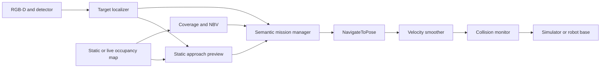

# Architecture, safety and verification status

This document describes source inspected during the 2026-11-15 restructuring. It is not evidence of a live ROS graph or physical safety. The detailed 2026-11-13 audit and historical results have separate scope and dates.

## Packages and platforms

- `asn_bringup`: launch orchestration and RViz configurations; the live-map simulation launch installs SLAM Toolbox and Nav2 launch includes.
- `asn_description`: robot description and meshes. `asn_simulation`: simulation assets and launch support; Isaac Sim supplies simulated sensors and motion.
- `asn_navigation`: Nav2, mapping and localization configuration. Simulation uses simulated time; TurtleBot 4 uses hardware configuration and wall time. Do not combine SLAM and AMCL map-to-odom authorities without a reviewed handoff.
- `asn_mission`: C++ waypoint manager, separate from semantic mission behavior.
- `asn_semantical_navigation`: RGB-D localization, measured coverage, NBV search, semantic mission supervision and static-map approach preview. Pure conservative grid geometry is in `planning/static_geometry.py`; the existing node entry points remain in place.
- `asn_semantical_navigation_mapless`: experimental independent reactive controller and semantic stack in odom coordinates; isolated command topic and motion disabled by default. It is not a substitute for Nav2 and is not cleared for physical operation.
- `asn_test`: project testing utilities. Test scripts elsewhere can command motion and must be classified before use.

The map is a static snapshot for approach preview: the conservative swept disk test checks all blocked/unknown map cells intersecting an expanded straight segment, including endpoints. Cell expansion is square, a conservative superset of the circular robot footprint, so valid routes can be rejected. The launch configuration specifies 0.22 m robot radius and 0.30 m approach-path radius; confirm that the real footprint and margin fit before use. This preview does **not** prove a dynamic path, stopping distance, or physical collision safety. Nav2 costmaps and collision monitor remain separate layers whose physical effectiveness is unverified.

## Interfaces and ownership

Semantic commands and status use `/semantic/search/*` and `/semantic/mission/*`. The mission manager coordinates NBV shutdown, locks the observed target, requests an approach preview and submits `/navigate_to_pose`. Direct approach is disabled by default. NBV executor, C++ waypoint manager, RViz and other clients may also send Nav2 goals. **There is no global atomic goal lease.** Status checks and local handoffs do not prevent simultaneous external requests. Do not run competing autonomy stacks or submit RViz/manual goals during a mission. A future arbiter must cover every autonomous client and define manual override before concurrent operation is considered supported.

A manual takeover requires an operator to request mission cancellation, wait for a terminal action result and independently confirm the robot has stopped before sending any new command. Cancellation acknowledgements mean acceptance of a cancellation request, not a stopped base. A dead client cannot guarantee cancellation; downstream command timeout and independent physical stop must be verified separately. Recovery goals are also navigation goals and must not overlap external control. These are operating constraints, not enforcement guarantees.

The usual intended frames are `map -> odom -> base_link` (hardware may also expose `base_footprint`); localization or SLAM owns map-to-odom and robot odometry owns odom-to-base. Never run conflicting publishers for the same transform. TF ownership and actual topic remaps must be verified in the deployed graph.

## Target-loss policy

The original capture timestamp must be positive and fresh against ROS time, receipt must be recent and belong to the current mission, the frame and pose must be valid, and validity must be true. A cached target cannot independently authorize motion. In preparation/search a valid fresh target initiates the stop and localization handoff. Before submission or goal acceptance, loss fails the approach. During a pending or accepted approach, target loss requests cancellation and fails the mission after cancellation reaches a terminal result. Temporary occlusion is therefore treated conservatively as loss; no grace period resumes motion automatically. A delayed acceptance after loss is canceled. An unacknowledged cancellation is an unsafe failure requiring operator intervention. ROS-time pauses and clock jumps, separate validity and pose topics, and action races still require isolated runtime integration testing; a timer that does not fire cannot guarantee cancellation.

## Stopping and platform limitations

Mission cancellation is a supervisory request; Nav2 cancellation is an action request whose terminal result must be observed. Neither is a physical stop. The hardware YAML configures a 1 s velocity-smoother timeout and 1 s collision-monitor source timeout, with smoothed input and `cmd_vel` output; these values do not prove the base watchdog or physical braking behavior. The software E-stop script and independent physical stopping are distinct mechanisms. Never disable collision monitoring or rely on any ROS timeout as proof of physical stopping.

No hardware commands or E-stop tests were run during this restructuring. Live dynamic obstacles, velocity expiry, DDS loss, simulator compatibility, action arbitration and the real stopping chain require separately supervised validation.

## Build and test classification

Build with a sourced ROS Jazzy environment and `colcon build` from `ros2_ws`; preserve platform-specific configuration. Existing hardware scripts and simulation launch paths remain in place. For safe tests, review each file first: pure geometry and policy tests have no ROS graph; node integration tests create ROS nodes and need a verified isolated graph; simulator-active tests require a verified isolated simulator and the user's Isaac Safe launcher; hardware-active tests require separate supervision and authorization. Do not run the entire test suite blindly. See `asn_semantical_navigation/test/test_static_geometry.py` and `test_target_loss_policy.py` for offline regressions. Failed experiments and original recordings remain historical evidence and must not be discarded.
